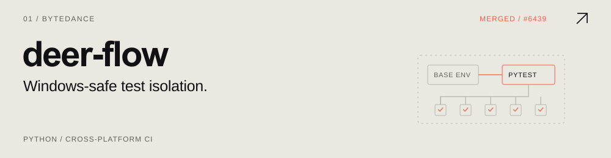
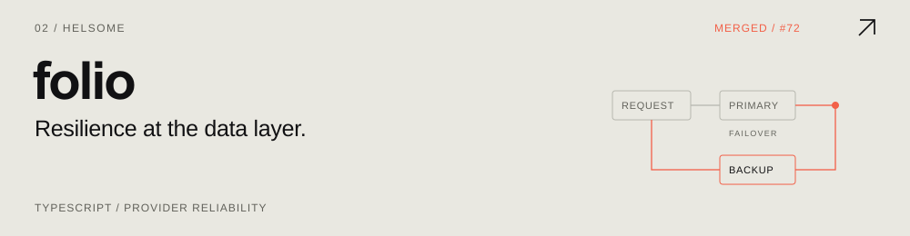
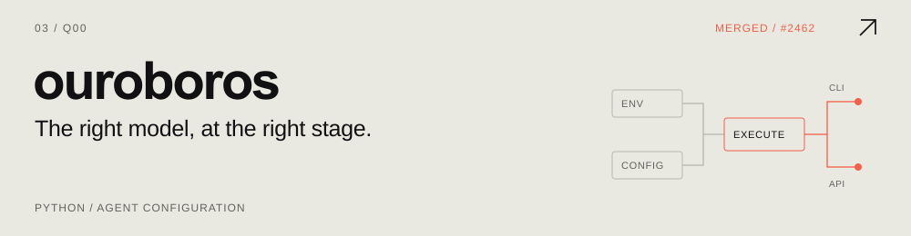

<picture>
  <source media="(prefers-color-scheme: dark) and (max-width: 600px)" srcset="assets/studio/cover-dark-mobile.svg">
  <source media="(max-width: 600px)" srcset="assets/studio/cover-light-mobile.svg">
  <source media="(prefers-color-scheme: dark)" srcset="assets/studio/cover-dark.svg">
  
</picture>

<br>

**Java / Python 后端 · AI Agent 工程化 · 开源贡献**<br>
关注 AI 系统的可靠性、跨平台兼容与工程边界。

### 01 / Selected contributions

以下是已合并到上游的精选贡献。点击卡片，查看代码、测试与评审记录。

<a href="https://github.com/bytedance/deer-flow/pull/6439">
<picture>
  <source media="(prefers-color-scheme: dark) and (max-width: 600px)" srcset="assets/studio/deerflow-dark-mobile.svg">
  <source media="(max-width: 600px)" srcset="assets/studio/deerflow-light-mobile.svg">
  <source media="(prefers-color-scheme: dark)" srcset="assets/studio/deerflow-dark.svg">
  
</picture>
</a>

**让 Windows 的测试隔离真正可运行，也能持续验证。**<br>
补齐隔离子进程必需的系统变量，并加入专项 Windows CI，覆盖环境契约和四项测试收集策略。

<details>
<summary>实现与验证 &nbsp; / &nbsp; 最小环境白名单 · Windows CI · 回归约束</summary>

- **问题定位**：通过 Windows / Ubuntu 测试对照，定位到隔离环境缺失 `SystemRoot` 等变量，导致 Python 子进程在测试收集前启动失败。
- **实现边界**：仅在 Windows 传递必要的基础系统变量，保持凭据隔离与 POSIX 行为。
- **回归保障**：新增专项 Windows 工作流，并验证它确实收集环境契约和全部四项策略测试，防止筛选条件漏跑。

[代码与评审记录 ↗](https://github.com/bytedance/deer-flow/pull/6439)

</details>

<br>

<a href="https://github.com/helsome/folio/pull/72">
<picture>
  <source media="(prefers-color-scheme: dark) and (max-width: 600px)" srcset="assets/studio/folio-dark-mobile.svg">
  <source media="(max-width: 600px)" srcset="assets/studio/folio-light-mobile.svg">
  <source media="(prefers-color-scheme: dark)" srcset="assets/studio/folio-dark.svg">
  
</picture>
</a>

**把数据源故障变成有边界、可追溯的降级过程。**<br>
为 Provider 层增加错误分型、有界重试、熔断、分类型缓存与故障转移溯源，以可选配置接入现有路由。

<details>
<summary>实现与验证 &nbsp; / &nbsp; 重试预算 · 熔断状态机 · 数据来源与新鲜度</summary>

- **重试与熔断**：区分可重试故障与认证等确定性错误；实现带退避和抖动的有界重试，以及按 Provider 隔离的三态熔断器。
- **降级语义**：按数据类型设置缓存有效期；所有实时数据源失败后才允许返回过期缓存，明确标记 `stale`，保留实际来源和失败路径。
- **兼容与验证**：未启用时保持原有行为；注入时钟与故障响应，覆盖限流、超时、熔断、缓存和回退等路径。PR 包含专项测试与类型检查记录。

[代码与评审记录 ↗](https://github.com/helsome/folio/pull/72)

</details>

<br>

<a href="https://github.com/Q00/ouroboros/pull/2462">
<picture>
  <source media="(prefers-color-scheme: dark) and (max-width: 600px)" srcset="assets/studio/ouroboros-dark-mobile.svg">
  <source media="(max-width: 600px)" srcset="assets/studio/ouroboros-light-mobile.svg">
  <source media="(prefers-color-scheme: dark)" srcset="assets/studio/ouroboros-dark.svg">
  
</picture>
</a>

**让执行阶段使用正确的模型，而不是意外继承评估阶段配置。**<br>
修复 Execute 规划角色的模型选择，保留显式覆盖优先级，并兼容不同后端的自动选择与回退行为。

<details>
<summary>实现与验证 &nbsp; / &nbsp; 阶段隔离 · 配置优先级 · 多后端兼容</summary>

- **问题定位**：异构后端配置下，Execute 角色误用 Evaluate 的模型标识，导致运行时调用失败。
- **修复方式**：复用现有 Execute 模型配置入口；环境变量覆盖持久化配置，调用方显式指定和旧版角色覆盖仍保留优先级。
- **回归保障**：覆盖三类执行角色、自动选择标记和多个 CLI 后端；为 LiteLLM 等保留带 Provider 信息的模型回退，其他阶段行为保持不变。

[代码与评审记录 ↗](https://github.com/Q00/ouroboros/pull/2462)

</details>

<br>

**More merged work** &nbsp; / &nbsp; [Octop · 服务识别](https://github.com/TencentCloud/Octop/pull/824) · [rome · Fast Refresh](https://github.com/rome-os/rome/pull/457) · [trinity · 失败归因](https://github.com/Abilityai/trinity/pull/2752)

[Browse all merged contributions ↗](https://github.com/pulls?q=is%3Apr+author%3Alouisss1016+is%3Amerged)

<br>

### 02 / Beyond the surface

<details>
<summary><b>The loop</b> &nbsp; / &nbsp; 封面线环是怎么画出来的？</summary>

<br>

它是一组环面的参数曲线，经三维旋转和投影后绘成 SVG。远处的线更暗，近处的线更亮，形成有深度的轮廓。

```text
x = (R + r cos v) cos u
y = (R + r cos v) sin u
z = r sin v
```

两个角度，一条闭环。和做工具一样：构建、验证、改进，再来一轮。

[打开绘制源码 ↗](https://github.com/louisss1016/louisss1016/blob/main/scripts/render_profile.py)

</details>

<details>
<summary><b>Debug room</b> &nbsp; / &nbsp; 找出一行代码里的边界问题</summary>

<br>

一个真实的修复现场：配置了 `https://ollama.com/v1`，却被当成本地服务，甚至无法删除。

```python
is_local = "11434" in url or "ollama" in url
```

<details>
<summary>找到问题了？展开对照修复思路</summary>

服务名称不能证明部署位置：`ollama.com` 同样包含 `ollama`。

修复细化了地址判断，覆盖本地地址、已知本地主机名和默认端口，并补充本地与云端 URL 测试。

[查看已合并的真实补丁 ↗](https://github.com/TencentCloud/Octop/pull/824)

</details>
</details>

<br>

---

<sub>LOUISSS &nbsp; / &nbsp; Build quietly. Ship often.</sub>
