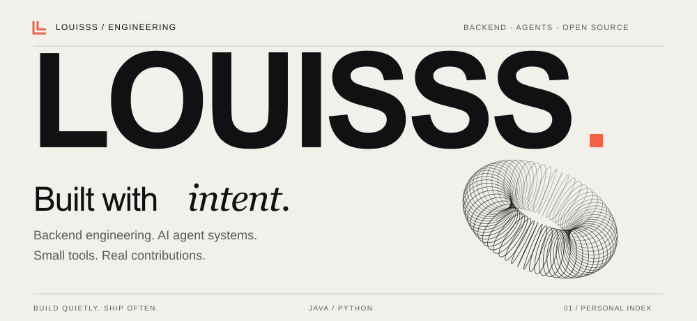
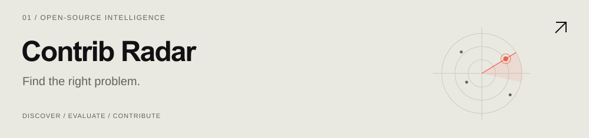
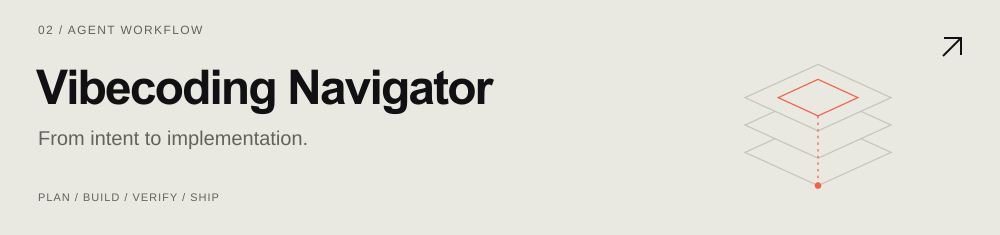

<picture>
  <source media="(prefers-color-scheme: dark) and (max-width: 600px)" srcset="assets/studio/cover-dark-mobile.svg">
  <source media="(max-width: 600px)" srcset="assets/studio/cover-light-mobile.svg">
  <source media="(prefers-color-scheme: dark)" srcset="assets/studio/cover-dark.svg">
  
</picture>

<br>

**Java / Python 后端 · AI Agent 工程化 · 开源工具**<br>
把重复的工作变成工具，把真实的问题修进开源。

### 01 / Selected work

<a href="https://github.com/louisss1016/contrib-radar">
<picture>
  <source media="(prefers-color-scheme: dark) and (max-width: 600px)" srcset="assets/studio/radar-dark-mobile.svg">
  <source media="(max-width: 600px)" srcset="assets/studio/radar-light-mobile.svg">
  <source media="(prefers-color-scheme: dark)" srcset="assets/studio/radar-dark.svg">
  
</picture>
</a>

发现值得投入的开源项目，评估 Issue 与冲突风险，持续跟进 PR。

<a href="https://github.com/louisss1016/vibecoding-navigator">
<picture>
  <source media="(prefers-color-scheme: dark) and (max-width: 600px)" srcset="assets/studio/navigator-dark-mobile.svg">
  <source media="(max-width: 600px)" srcset="assets/studio/navigator-light-mobile.svg">
  <source media="(prefers-color-scheme: dark)" srcset="assets/studio/navigator-dark.svg">
  
</picture>
</a>

让 AI 编程有清晰的推进路径：需求拆解 → 实现 → 验证 → 上线。

<br>

### 02 / Selected contributions

**[deer-flow](https://github.com/bytedance/deer-flow/pull/6439)** &nbsp; / &nbsp; Windows 测试环境修复<br>
<sub>让隔离测试子进程获得必需的系统环境变量。 · MERGED #6439</sub>

**[Octop](https://github.com/TencentCloud/Octop/pull/824)** &nbsp; / &nbsp; 云端与本地服务识别<br>
<sub>修复 Ollama 云端地址被误判为本地运行时。 · MERGED #824</sub>

**[ouroboros](https://github.com/Q00/ouroboros/pull/2462)** &nbsp; / &nbsp; Agent 模型配置修复<br>
<sub>让 Execute 阶段的规划角色遵循指定模型。 · MERGED #2462</sub>

[All merged contributions ↗](https://github.com/pulls?q=is%3Apr+author%3Alouisss1016+is%3Amerged)

<br>

### 03 / Beyond the surface

<details>
<summary><b>The loop</b> &nbsp; / &nbsp; 封面线环是怎么画出来的？</summary>

<br>

它是一组环面的参数曲线，经三维旋转和投影后绘成 SVG。远处的线更暗，近处的线更亮，形成有深度的轮廓。

```text
x = (R + r cos v) cos u
y = (R + r cos v) sin u
z = r sin v
```

两个角度，一条闭环。和做工具一样：构建、验证、改进，再来一轮。

[打开绘制源码 ↗](https://github.com/louisss1016/louisss1016/blob/main/scripts/render_profile.py)

</details>

<details>
<summary><b>Debug room</b> &nbsp; / &nbsp; 找出一行代码里的边界问题</summary>

<br>

一个真实的修复现场：配置了 `https://ollama.com/v1`，却被当成本地服务，甚至无法删除。

```python
is_local = "11434" in url or "ollama" in url
```

<details>
<summary>找到问题了？展开对照修复思路</summary>

服务名称不能证明部署位置：`ollama.com` 同样包含 `ollama`。

修复细化了地址判断，覆盖本地地址、已知本地主机名和默认端口，并补充本地与云端 URL 测试。

[查看已合并的真实补丁 ↗](https://github.com/TencentCloud/Octop/pull/824)

</details>
</details>

<br>

---

<sub>LOUISSS &nbsp; / &nbsp; Build quietly. Ship often.</sub>
